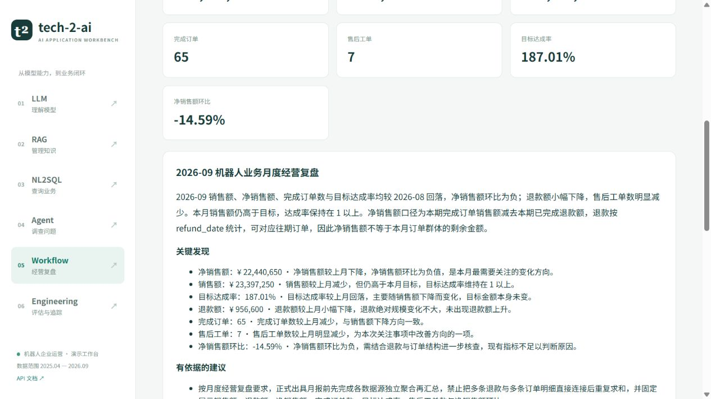

# 本轮升级验收记录

验证日期：2026-10-20。使用当前用户配置的 deepseek-flash、真实本地 bge-small-zh-v1.5 嵌入模型与 Qdrant 本地持久化模式。未覆盖现有 .env，未修改旧 Qdrant 集合。

## 验证结果

| 检查 | 结果 |
| --- | --- |
| 后端 pytest | 40 项通过；含 SQL 越界、昂贵查询、指标口径、版本替换、删除失败、取消、Agent 预算、引用、任务与追踪 |
| Ruff 检查与格式 | 通过，120 列 |
| 前端 Node SSE 测试 | 2 项通过，覆盖 UTF-8 分片、CRLF、结束事件与中断 |
| 前端格式与生产构建 | 通过，页面按需分包 |
| Python pip check | 无依赖冲突 |
| npm audit | 0 个已报告漏洞 |
| 后端冷导入 | 实测约 2 秒；Torch、Transformers、Sentence Transformers 未导入 |
| 真实冒烟 | 13 项通过：原生/框架的六种输出、入库、检索、引用回答、NL2SQL、Agent、Workflow、少量评估 |
| 完整真实评估首轮 | 43 / 48；保留失败记录 |
| 失败项定向复测 | 5 / 5 |
| 修复后完整真实评估 | 48 / 48 |

最后完整评估涵盖 24 SQL、12 检索、4 LLM、4 Agent、4 Workflow。

首轮揭示并修复：Schema 状态枚举缺失、SQL 丢失明确区域约束、调查拆分过细造成工具预算耗尽、月报金额单位换算误判、结构化报告解析失败未受控重试。

完整轮次 ID、分类结果、耗时与源码/数据指纹保存在 [verification.json](verification.json)。运行数据库中仍保留各轮 Trace 和失败用例结果，未删除或改写历史失败来获得通过率。

## 业务数据

8 张表，1527 条订单、3034 条明细、120 个客户、192 条退款、214 条售后工单、72 条月度目标，以及4个部门和4个产品。固定种子20260930，范围2025-04至2026-09。另有可手工核对的小样例生成选项。

28 份知识材料已实际入库；文档原件、版本、片段、索引与查询来源能够关联。

## 浏览器验收

已检查六个页面。真实操作验证：RAG 检索返回来源、NL2SQL 显示 SQL 与四个部门结果、Agent 历史会话显示调查结论和证据、Workflow 从任务进度到报告展示、Engineering 查询运行及节点耗时、LLM 流式回答完成后显示模型与用量。

## 可复现范围

自动化测试不使用真实 API。真实冒烟与 Golden Cases 评估会调用外部模型，结果可能随模型及数据变化；48/48 表示本轮固定用例通过，不表示任意业务问题都可靠。

当前交付为单用户、单进程本地工作台。任务状态和结果可跨重启保留，执行本身不跨进程恢复；未完成任务标记 interrupted。完整云端 LangSmith 上传没有在本轮开启验证，本地追踪已验证。

Starlette TestClient 会产生一条上游 anyio 兼容性弃用警告，测试全部通过。
